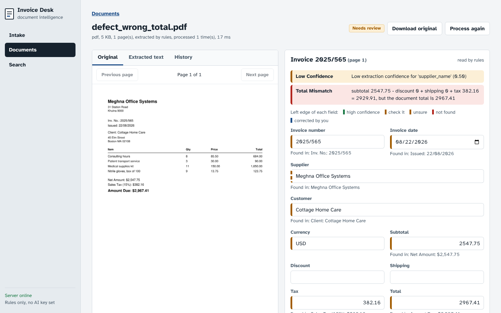

# Invoice Desk: AI-powered document intelligence system

Upload invoices as PDF, scanned PDF, JPG/PNG/TIFF, XLSX/XLS or CSV. The system reads them (text layer, OCR or
spreadsheet parser), extracts the invoice data with Gemini, validates the numbers, flags what needs a human, lets a
reviewer correct it, and makes everything searchable (keyword, semantic and hybrid). Built for the *AI Engineer*
assessment (Tasks 1 to 7).



| Task | What was built | Where |
|---|---|---|
| 1 Document processing | PDF text layer + per-page OCR fallback, JPG/PNG/multi-page TIFF OCR with OpenCV clean-up (deskew, denoise, upscale, orientation), XLSX/XLS/CSV with multiple sheets, encodings and delimiters; corrupted / encrypted / empty files are rejected or flagged with a clear reason | `backend/app/processing/` |
| 2 AI extraction | Gemini returns JSON with `value`, `confidence` and `evidence` per field. Missing = `null`. Every value is checked against the source text; values that are not in the document are dropped (never invented) | `backend/app/extraction/` |
| 3 Validation | missing fields, unreadable numbers, negative / zero values, subtotal + tax = total (with discount and shipping), qty x price = line amount, line items = subtotal, duplicate invoices (exact and possible), odd dates; anything wrong sets `needs_review` | `backend/app/validation.py` |
| 4 Backend API | REST API (FastAPI): upload, status, results, text, history, search, manual corrections, approve, reprocess one / all failed, stats. OCR and AI run in Celery workers (Redis) | `backend/app/api/`, `worker.py` |
| 5 Database and search | PostgreSQL 16: metadata, text per page, structured results, validation errors, processing history, corrections audit. Keyword search = full-text index; semantic = pgvector (HNSW); hybrid = rank fusion | `docs/database.md`, `search.py` |
| 6 Frontend | React + TypeScript: multi-file upload with progress, live processing queue, review screen (original beside the data, confidence markers, evidence, edit, approve), document list, search | `frontend/` |
| 7 Testing and evaluation | 249 automated tests (93% line coverage), labelled dataset, measured accuracy / time / success / failure report | `backend/tests/`, `eval/`, `docs/evaluation.md` |

## Quick start (Docker)

1. Get a free Gemini API key: open <https://aistudio.google.com/apikey>, sign in, press **Create API key**.
2. ```bash
   cp .env.example .env            # then edit .env: paste GEMINI_API_KEY, set API_KEY to a long random string
   docker compose up --build       # first build takes a few minutes
   ```
3. Open <http://localhost:8080> (UI) and <http://localhost:8000/docs> (interactive API docs: press **Authorize** and paste your `API_KEY`; scripts send it as the `X-API-Key` header).

Check that Gemini works for your key (10 seconds): `python scripts/check_gemini.py`, or without a local Python:
`docker compose run --rm -v ./scripts:/srv/scripts worker python /srv/scripts/check_gemini.py`. It prints what to change if something is wrong.

Without a Gemini key everything still works: extraction falls back to deterministic rules and the UI says
"Rules only, no AI key set". More workers: `docker compose up --build --scale worker=3`.

**Privacy note.** On Gemini's free tier, Google may use the content you send to improve its products. Use sample or
synthetic documents (the repo includes 42 in `eval/dataset/`). For real customer invoices use a paid key or another provider.

## Run without Docker (development)

```bash
# backend: SQLite + jobs run inline, no Redis/Postgres needed
sudo apt install tesseract-ocr          # macOS: brew install tesseract   Windows: install Tesseract and add it to PATH
cd backend && pip install -r requirements-dev.txt
CELERY_ALWAYS_EAGER=true uvicorn app.main:app --reload          # http://localhost:8000/docs
# frontend
cd frontend && npm install && npm run dev                        # http://localhost:5173  (proxies /api to :8000)
```
Production-like: run PostgreSQL (with the `vector` extension) and Redis, set `DATABASE_URL` / `REDIS_URL`, start the API
(`uvicorn app.main:app`) and a worker (`celery -A app.worker.celery_app worker --concurrency=2`).

## Configuration (environment variables, see `.env.example`)

| Variable | Default | Meaning |
|---|---|---|
| `GEMINI_API_KEY` | empty | enables AI extraction and embeddings |
| `GEMINI_MODEL` / `GEMINI_FALLBACK_MODELS` | `gemini-3.5-flash` / `gemini-3.1-flash-lite,gemini-2.5-flash` | tried in order when a model is gone or out of quota. Model names change often: check <https://ai.google.dev/gemini-api/docs/models> and your quota in AI Studio |
| `EXTRACTOR` | `auto` | `auto` (Gemini if key) / `llm` / `rules` |
| `API_KEY` | empty | shared secret, header `X-API-Key`. Empty disables auth (local only) |
| `RATE_LIMIT_PER_MINUTE` | 0 | per client IP, Redis based |
| `OCR_THREADS`, `OCR_DPI`, `OCR_LANG` | 2, 200, `eng` | add Tesseract language packs for e.g. Bangla: `OCR_LANG=eng+ben` |
| `LLM_CONCURRENCY` | 4 | parallel Gemini calls per worker |
| `POSTGRES_PASSWORD` | `docintel` | database password for the compose stack: set your own before the first start |
| `MAX_UPLOAD_MB`, `MAX_PAGES` | 200, 3000 | per file limits |
| `DATE_DAYFIRST` | true | how `03/04/2025` is read when ambiguous (flagged as info) |

## API overview (`/api/v1`, full docs at `/docs`)

| Method and path | Purpose |
|---|---|
| `POST /documents` | upload one or many files (multipart `files`); returns `accepted` and `rejected` (with reasons); processing is queued |
| `GET /documents` | list with filters `status`, `needs_review`, `file_type`, `q`, `sort`, `limit`, `offset` |
| `GET /documents/{id}/status` | stage and progress (for polling) |
| `GET /documents/{id}/result` | invoices, line items, per-field confidence and evidence, validation issues |
| `GET /documents/{id}/text`, `/events`, `/file`, `/pages/{n}/image` | extracted text, processing history, original file, page preview PNG |
| `PATCH /invoices/{id}` | manual correction (audit trail, re-validation); `POST /invoices/{id}/approve` |
| `POST /documents/{id}/reprocess`, `POST /documents/reprocess-failed` | failed-job reprocessing |
| `GET /search?q=&mode=keyword\|semantic\|hybrid` | plus filters supplier, currency, date range, total range, status |
| `GET /stats`, `GET /health`, `POST /reindex` | operations |

## Secrets and a public repository

* API keys live only in `.env` on your machine (git-ignored). The repository holds `.env.example` with empty values.
* Docker passes keys at run time. They are never copied into an image or into the JavaScript bundle (nginx adds the API key to proxied requests).
* `make hooks` installs a git hook that blocks any commit or push containing an API key or token; `make secrets` scans on demand;
  `python scripts/check_secrets.py --history` checks the whole git history (the scanner has its own tests).
* If a key ever leaks: delete it at <https://aistudio.google.com/apikey>, create a new one, and remove it from git history (or start a fresh repository).
* Generate the shared `API_KEY` with `python -c "import secrets; print(secrets.token_hex(32))"`.

## Design decisions

| Decision | Why |
|---|---|
| **Python (FastAPI + Celery) instead of Node/NestJS** | OCR, PDF, pandas and embedding libraries are Python. One language removes a Node-to-Python bridge. Celery gives what BullMQ would: retries, late acknowledgement, horizontal scaling |
| **PostgreSQL + pgvector instead of a separate vector database** | one transactional store for metadata, full-text (GIN) and vectors (HNSW); hybrid search needs no cross-system joins. Move vectors out only at tens of millions of chunks |
| **Digital text first, OCR only where needed (per page)** | 100x faster and exact; mixed PDFs work; 1000 digital pages take seconds |
| **LLM returns evidence, code verifies it ("grounding")** | prevents invented values: a number, name, date or currency that cannot be found in the document is dropped and shown to the reviewer as "the AI proposed X but it is not in the document" |
| **Rules fallback + model fallback chain** | an API outage, quota or model retirement degrades quality (and flags the invoice) instead of stopping the business |
| **Spreadsheets parsed deterministically** | already structured: exact, free, instant. Form-style sheets go through text extraction |
| **Split large PDFs into invoices by invoice number** | one LLM call per invoice, bounded prompt size; a 1000-page file is a stream of small jobs |
| **Human review built in** | every field shows confidence and the evidence line; corrections are audited and re-validated |
| **API key added by the nginx proxy, not by the browser** | the secret never appears in the JavaScript bundle. Put the UI behind SSO / VPN in production |

## Security

Files are identified by content (magic bytes), extension allow-list, streamed to disk with a size cap, stored under
server-generated names (no path traversal), decompression-bomb / page-count / OCR-time limits. API key compared in constant
time, Redis rate limit, CORS allow-list, `nosniff` / frame / referrer headers, CSP on the UI, non-root containers, secrets only
in `.env` (git-ignored). SQL is parameterised (SQLAlchemy) and LIKE / full-text input is escaped. Document text is treated as
untrusted data: model output is parsed as data, verified against the text and never executed.
**Not included** (would be next): per-user accounts and roles, malware scanning, encryption at rest, audit of reads.

## Scalability, speed, reliability

* API is stateless; add workers with `--scale worker=N`; OCR uses a thread pool per worker; 1000-page PDFs stream page by page with
  progress; inserts are batched; every list endpoint is paginated; progress writes are throttled.
* Measured on 1 CPU core (see `docs/evaluation.md`): 1000-page digital PDF in seconds, scanned pages about 1.4 s each.
* Reliability: retries with backoff, model fallback, rules fallback, per-page error isolation, row-locked job claiming (no double
  processing), automatic re-queue of jobs stuck after a worker crash, failed state with reason + reprocess, health endpoint.

## Tests and evaluation

```bash
make test        # 249 tests, SQLite, no services needed
make test-pg     # same suite on PostgreSQL + pgvector (needs a local Postgres)
make eval-rules  # offline baseline  -> docs/evaluation.md
make eval        # with Gemini (needs GEMINI_API_KEY) -> regenerates docs/evaluation.md with the LLM numbers
make eval-docker # the same inside the worker container (no local Python / Tesseract needed)
make test-report # runs the tests and writes docs/test-results.md
```
Tests cover document processing, OCR (rotation, blur, low resolution, TIFF, blank, corrupt), spreadsheet parsing, AI extraction
(mocked Gemini: retries, model fallback, outage, garbage output, hallucinated values), validation, all API endpoints, security
(auth, rate limit, upload attacks) and failure scenarios (queue outage, crashes, stuck jobs, concurrent workers on PostgreSQL).

**Verification status, stated plainly**

| Part | Verified how |
|---|---|
| Backend, pipeline, search, API | automated tests on SQLite and on PostgreSQL 16 + pgvector; API + Celery worker + Redis + PostgreSQL run together as separate processes |
| Frontend | TypeScript strict build; real browser run (Chromium) through upload, review, approve, search |
| Gemini calls | **not callable from the environment where this was built**: tested with a mocked client that reproduces the SDK's errors. Run `make eval` with your key to measure the real model |
| Docker files | written to run the same commands; Docker itself was not available where this was built |
| Evaluation data | synthetic (known ground truth), small: use it to compare and catch regressions, expect lower numbers on real invoices |

## Repository layout

```
backend/app/{api,processing,extraction}   routes | PDF, OCR, sheets | LLM, rules, grounding, segmentation
backend/app/{pipeline,validation,search,embeddings,worker}.py
backend/tests/                            automated tests          eval/   dataset generator, evaluation, benchmark
frontend/src/                             React UI                 docs/   architecture, database, evaluation
```
More: [architecture](docs/architecture.md), [database](docs/database.md) ([schema.sql](docs/schema.sql)),
[evaluation](docs/evaluation.md), [test results](docs/test-results.md).
