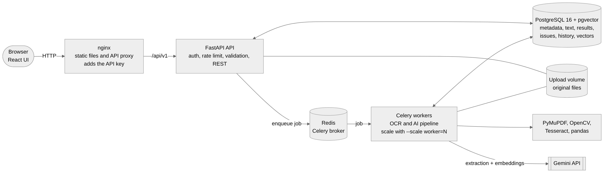
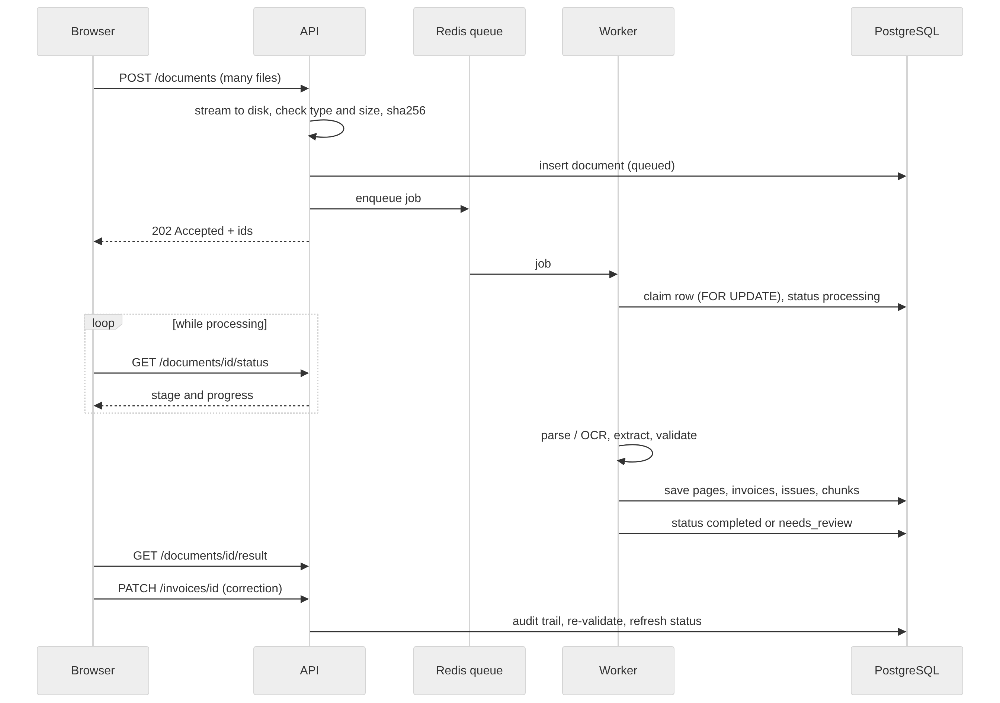
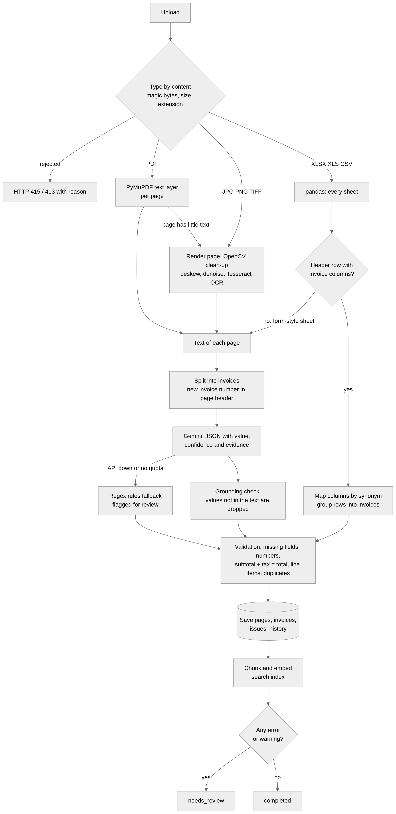

# Architecture

## Components

* **nginx** serves the React build and proxies `/api` to the API. It adds the `X-API-Key` header, so the key never reaches the browser.
* **API (FastAPI)**: authentication, rate limiting, upload validation, REST endpoints, search. Stateless, so run as many replicas as needed.
* **Redis + Celery workers**: all slow work (OCR, LLM, embeddings) runs here. `acks_late` + `reject_on_worker_lost` re-deliver a job if a
  worker dies; the pipeline claims a document under a row lock, so duplicate deliveries are ignored. A janitor (API thread and worker start-up)
  re-queues jobs stuck in `processing` for more than 15 minutes.
* **PostgreSQL 16 + pgvector**: the single source of truth (see [database](database.md)).
* **Gemini**: structured extraction (`gemini-3.5-flash` by default, with fallbacks) and text embeddings (`gemini-embedding-001`).

## Request flow

## Processing pipeline

Stages and progress: parsing / OCR (3-55 %), extracting (55-85 %), validating (86 %), indexing (92 %), done (100 %). Every stage writes a row to
`processing_events` (timing and message), which the UI shows under *History*.

## How extra care is taken against wrong data

1. The model must give **evidence** (the exact words it used). Code checks the evidence and the value against the text.
2. Amounts must exist in the document's numbers; dates need a year in the evidence; currencies need a symbol, code or name in the text;
   line items whose description is not in the text are dropped.
3. A value that fails the check becomes `null` (kept in metadata as `rejected_value` for the reviewer).
4. Validation then compares the numbers with each other (subtotal, tax, discount, shipping, line items, total).
5. Low confidence, any rule violation, a degraded OCR scan, or use of the rules fallback sets `needs_review`.

## Failure handling

| Situation | What happens |
|---|---|
| unsupported / empty / wrong-content file | rejected at upload with a reason; nothing stored |
| corrupted PDF / image / spreadsheet, password-protected PDF | job ends `failed` with a readable reason; worker continues; can be reprocessed |
| damaged but recoverable PDF | processed, flagged `FILE_WARNING` |
| one page cannot be read / OCR crashes on a page | that page is marked `error`; other pages continue; document flagged |
| blank or unreadable scan | `NO_TEXT` error, `needs_review` |
| Gemini timeout, 429, 5xx | exponential backoff, then next model in the chain, then rules fallback (flagged `LLM_FALLBACK`) |
| Gemini returns non-JSON | retried, then rules fallback |
| invalid API key | rules fallback + flag (visible in every invoice) |
| embedding API fails | the document is still completed; offline hashing embedder is used for its chunks |
| Redis down at upload | document kept, marked `failed` ("could not queue"), reprocess later |
| worker killed mid-job | job re-queued (late ack, janitor); claim lock prevents double work |
| unexpected exception | caught, document `failed` with the error, stack trace in History |

## Scaling notes

* OCR is the bottleneck (about 1.4 s/page/core): add worker containers or cores; digital PDFs and spreadsheets are cheap.
* Gemini calls are I/O bound: raise `LLM_CONCURRENCY` until you reach your quota.
* The first thing to outgrow is the HNSW index memory; text chunks per document are capped (`MAX_TEXT_CHUNKS_PER_DOC`), keyword search always covers the full text.
* For very large installations add: object storage instead of a shared volume, Alembic migrations, per-tenant auth, and a dedicated queue per workload (OCR vs LLM).
