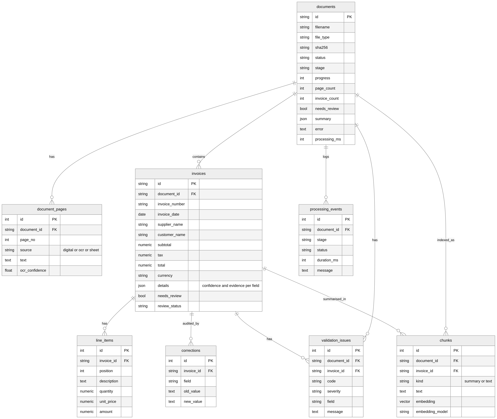

# Database design

PostgreSQL 16 with the `vector` extension. Full DDL: [`schema.sql`](schema.sql) (generated from the models). Tables are created on API start-up
(`Base.metadata.create_all` under an advisory lock, safe with many replicas); for production use Alembic.

| Table | Purpose | Notes |
|---|---|---|
| `documents` | one row per uploaded file: metadata, status, stage, progress, summary, error | indexes on `status`, `needs_review`, `created_at`, `sha256` |
| `document_pages` | extracted text per PDF page / image frame / sheet, source (`digital`, `ocr`, `sheet`), OCR confidence | GIN full-text index on `to_tsvector('simple', text)` |
| `invoices` | structured result (one document can hold many invoices) with `details` JSON: confidence, evidence, rejected values per field | normalised `invoice_number_norm`, `supplier_norm` + composite index make duplicate checks fast |
| `line_items` | invoice rows | |
| `validation_issues` | code, severity (`error`/`warning`/`info`), field, message; per invoice or per document | |
| `processing_events` | processing history: stage, status, duration, message | |
| `corrections` | audit trail of manual edits (old / new value) | |
| `chunks` | text chunks and invoice summaries with `embedding vector(768)` and the embedding model name | HNSW index (cosine) |

Design points

* **Money** is `NUMERIC(18,4)`, never float; validation uses `Decimal`.
* **Cascading deletes** keep the data consistent (`ON DELETE CASCADE`).
* **Keyword search** = `websearch_to_tsquery('simple', ...)` over page text + case-insensitive match on invoice number / supplier / customer.
  The `simple` configuration avoids stemming, which would damage invoice numbers and names.
* **Semantic search** = cosine distance on `chunks.embedding`, filtered by `embedding_model` (vectors from different models are never compared).
  Without a Gemini key an offline hashing embedder is used (good for typos and shared words, weaker for paraphrases); `POST /reindex` re-embeds everything
  after a model change.
* **Hybrid** = reciprocal rank fusion of both lists, then structured filters (supplier, currency, date range, total range, status) apply to all three modes.
* Changing `EMBED_DIM` changes the column type and needs a migration.
